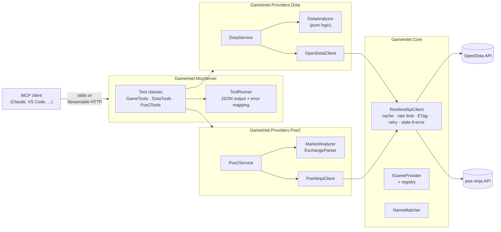

# Game Intel MCP

[](https://github.com/InfamouslyGreedy/game-intel-mcp/actions/workflows/ci.yml)


A **Model Context Protocol (MCP) server in .NET** that gives AI agents live data from **Dota 2** and **Path of Exile 2**. Ask Claude, Copilot or any MCP client things like:

> *"How have I been playing the last 20 games? My account is 86745912."*
> *"I'm on Juggernaut and they just picked Phantom Assassin. What should I build?"*
> *"What's a Divine Orb worth right now, and what currency is moving the most this league?"*

The agent picks the right tools, the server does the fetching, caching, rate limiting and math, and the agent turns the result into advice.

Games are **pluggable providers**: adding a third game is a new project plus one line of registration, with no changes to existing providers.

---

## Tools

| Tool | What it answers | Data source |
|---|---|---|
| `list_games` | Which games are supported, their capabilities, and live upstream health | — |
| `dota2_player_summary` | Rank, win rate, KDA, GPM/XPM, streak, most-played heroes, per-match list | OpenDota |
| `dota2_hero_matchups` | Best and worst opponents for a hero (counter-picking) | OpenDota |
| `dota2_item_build` | Most purchased items per game phase, with costs | OpenDota |
| `dota2_list_heroes` | All heroes with attribute and roles | OpenDota |
| `poe2_leagues` | Leagues with economy data (current league first) | poe.ninja |
| `poe2_price_check` | Price of any exchange item in both reference currencies, with trend and volume | poe.ninja |
| `poe2_most_valuable` | Most valuable items in a category ("what's worth farming?") | poe.ninja |
| `poe2_market_movers` | Biggest price swings in a category, filtered for liquidity | poe.ninja |

Inputs are forgiving on purpose, because agents pass through whatever the user typed: `am`, `anti mage` and `Anti-Mage` all resolve; `divine` finds *Divine Orb*; a typo gets a "did you mean…" back instead of a dead end.

---

## Architecture



| Project | Responsibility | Depends on MCP SDK? |
|---|---|---|
| `GameIntel.Core` | `IGameProvider` contract, resilient HTTP client, fuzzy name matching | No |
| `GameIntel.Providers.Dota` | OpenDota client, Dota use cases and analysis | No |
| `GameIntel.Providers.Poe2` | poe.ninja client, tolerant parser, market analysis | No |
| `GameIntel.McpServer` | MCP tools (thin adapters), transports, configuration | **Yes** |
| `GameIntel.Tests` | Unit tests for all of the above | No |

Only the host knows about MCP. The domain code is plain .NET and could sit behind a REST API, a Discord bot or a different agent protocol unchanged.

---

## Design decisions

**Providers are plugins, tools are adapters.** Each game implements `IGameProvider` and registers itself with one extension method (`AddDotaProvider`, `AddPoe2Provider`). Game-agnostic tools like `list_games` enumerate providers through DI and work for any game added later. Tool classes contain no logic: they clamp inputs, call a service, and hand the result to `ToolRunner`.

**Be a polite API client.** OpenDota and poe.ninja are free community services that ask clients to cache and throttle, and block the ones that don't. Every request goes through `ResilientApiClient`, which layers:

- **In-memory caching** with a freshness window per dataset: hero constants 24 h, aggregate stats 6 h, PoE 2 prices 15 min (poe.ninja refreshes about hourly), a player's matches 2 min.
- **A token-bucket rate limiter** shared across the process. Requests queue instead of failing.
- **ETag revalidation.** Stale entries are re-checked with `If-None-Match`, so an unchanged dataset costs the upstream a 304.
- **Retries with exponential backoff and jitter** for 429, 5xx and network errors, honouring `Retry-After`.
- **Stale-if-error.** If the upstream is down, the last good copy is served (and logged) instead of failing the user's question.

**Tolerant reader for undocumented schemas.** poe.ninja documents field names but not types, and offers no versioning. `ExchangeParser` reads raw `JsonElement`s and accepts the plausible variants (ids as strings or objects, metadata as a map or an array, numbers as strings), skipping lines it can't read rather than failing the whole call. Each variant is covered by a test.

**Pre-digested output for the model.** Tools return flat, labelled JSON with hero and item names resolved, percentages rounded, and context notes ("win rates are from this hero's perspective", "items under 10 volume excluded"). The model spends its tokens on advice, not on joining ids or doing arithmetic.

**Errors the agent can act on.** Expected failures (unknown hero, private profile, unknown category) become MCP tool errors with a helpful message, often with suggestions. Unexpected exceptions are logged server-side and reported generically, so stack traces and upstream details never reach the client.

**stdout is sacred in stdio mode.** All logging goes to stderr, because a single stray log line on stdout corrupts the MCP stream.

**Staying within each source's rules.** Only poe.ninja's documented, supported economy endpoints are used. Its builds and character routes are internal, so this project doesn't touch them. Clients send a descriptive `User-Agent`, as poe.ninja asks.

---

## Getting started

### Prerequisites
- [.NET 10 SDK](https://dotnet.microsoft.com/download)

### Build and test
```bash
git clone https://github.com/InfamouslyGreedy/game-intel-mcp.git
cd game-intel-mcp
dotnet build GameIntel.slnx
dotnet test GameIntel.slnx
```

### Use it from an MCP client (stdio)

Publish once, then point your client at the output:

```bash
dotnet publish src/GameIntel.McpServer -c Release -o ./publish
```

**Claude Desktop** (`claude_desktop_config.json`):
```json
{
  "mcpServers": {
    "game-intel": {
      "command": "dotnet",
      "args": ["/absolute/path/to/game-intel-mcp/publish/game-intel-mcp.dll"]
    }
  }
}
```

**Claude Code:**
```bash
claude mcp add game-intel -- dotnet /absolute/path/to/game-intel-mcp/publish/game-intel-mcp.dll
```

**VS Code** (`.vscode/mcp.json`):
```json
{
  "servers": {
    "game-intel": {
      "type": "stdio",
      "command": "dotnet",
      "args": ["${workspaceFolder}/publish/game-intel-mcp.dll"]
    }
  }
}
```

### Run as an HTTP service (Docker)
```bash
docker build -t game-intel-mcp .
docker run -p 8080:8080 -e Mcp__ApiKey=change-me game-intel-mcp
```
- MCP endpoint: `http://localhost:8080/mcp` (send `X-Api-Key: change-me` when an API key is configured)
- Health: `http://localhost:8080/healthz` (reports each provider's upstream status)

Or without Docker: `dotnet run --project src/GameIntel.McpServer -- --http`.

### Configuration

Everything has a working default. Override in `appsettings.json`, with environment variables (`Providers__Dota2__ApiKey=...`), or with user secrets.

| Setting | Default | Notes |
|---|---|---|
| `Providers:Dota2:ApiKey` | none | Optional [OpenDota key](https://www.opendota.com/api-keys) for higher limits |
| `Providers:Dota2:PermitsPerMinute` | 60 | OpenDota free tier: 60/min, 2,000/day |
| `Providers:Poe2:PermitsPerMinute` | 12 | Well under anything poe.ninja would consider heavy |
| `Providers:*:UserAgent` | `GameIntelMcp/0.1 (+repo url)` | **Set this to your repo URL** so API owners can reach you |
| `Providers:*:MaxRetries` | 3 | |
| `Providers:*:StaleRetention` | 06:00:00 | How long a stale copy may be served if the upstream is down |
| `Mcp:ApiKey` | none | HTTP mode only: requires `X-Api-Key` on `/mcp` when set |

### Dota 2 profile privacy
OpenDota can only see public match data. In Dota 2: **Settings → Options → Social → Expose Public Match Data**. Your account id is the number in your OpenDota or Dotabuff profile URL; a 64-bit Steam id works too.

---

## Testing

Unit tests cover the parts that are easy to get subtly wrong:

- **HTTP resilience:** cache hits, ETag revalidation, retry on 429/5xx, giving up, stale-if-error, 404 not retried, garbage payloads. Uses a stub `HttpMessageHandler` and a controllable `TimeProvider`.
- **Dota rules:** rank-tier decoding, Steam64→account id, Radiant/Dire win logic, KDA and streaks, matchup filtering, item naming. Includes the hero names players actually type (`am`, `sf`, `np`, `furion`, `pango`).
- **PoE 2 economy:** each tolerated schema variant, currency conversion, cross-category search, liquidity filtering, league resolution.

Recorded upstream responses live in `tests/GameIntel.Tests/Fixtures`.

---

## Adding a game

See [docs/adding-a-game.md](docs/adding-a-game.md). In short: create `GameIntel.Providers.<Game>`, implement `IGameProvider` and a typed client on top of `ResilientApiClient`, add an `Add<Game>Provider()` extension, write a `<Game>Tools` class, and register both in `ServerSetup.cs`.

---

## Roadmap

- [ ] **PoE 2 characters** via GGG's official OAuth API (public client + PKCE), e.g. "explain my build" and "what should I upgrade next"
- [ ] **Azure deployment:** Bicep for Azure Container Apps, with Key Vault for secrets and Entra ID auth in front of `/mcp`
- [ ] **OpenTelemetry** traces and metrics (cache hit rate, upstream latency, tool usage)
- [ ] **Distributed cache** (Redis) so multiple replicas share cached data and rate budgets
- [ ] **MCP prompts and resources**, e.g. a "draft helper" prompt and hero/item reference resources
- [ ] **Integration tests** against the real APIs on a nightly schedule to catch upstream schema drift

---

## Data sources

- Dota 2 data: [OpenDota](https://www.opendota.com) ([API docs](https://docs.opendota.com))
- Path of Exile 2 economy data: [poe.ninja](https://poe.ninja) ([API docs](https://poe.ninja/docs/api))

This project is not affiliated with or endorsed by Valve, Grinding Gear Games, OpenDota or poe.ninja.

## License

[MIT](LICENSE)
